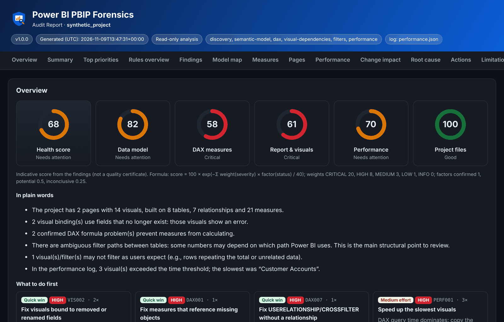
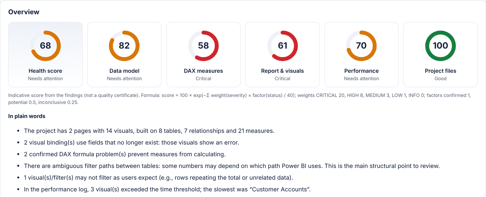
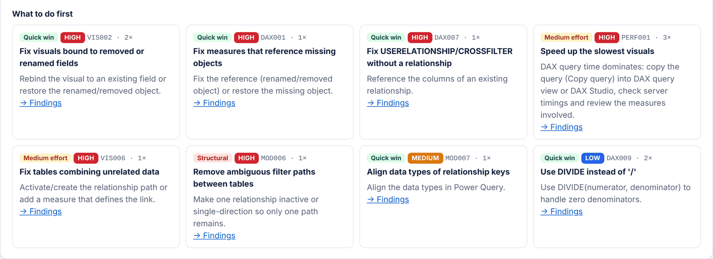
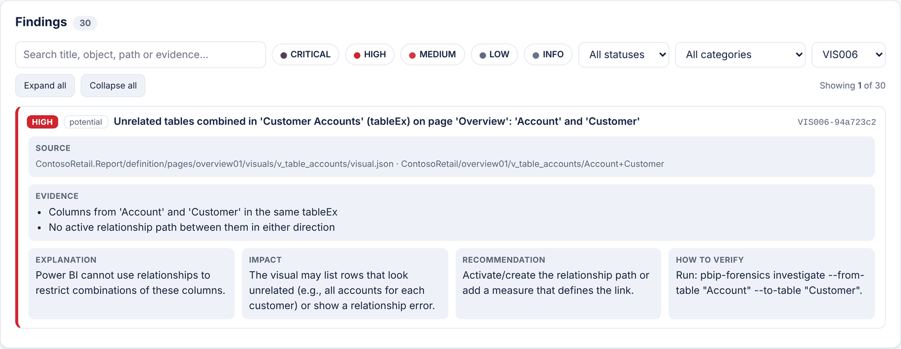
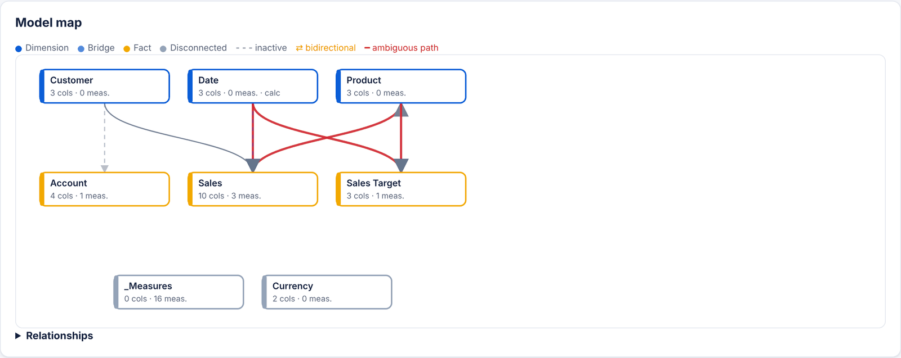
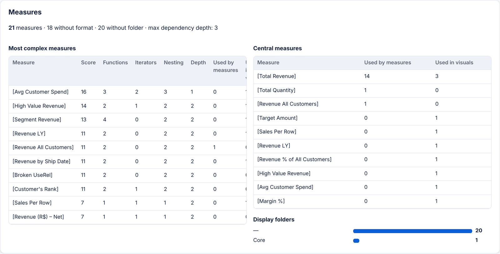
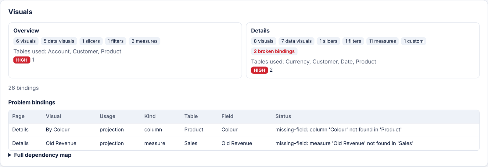
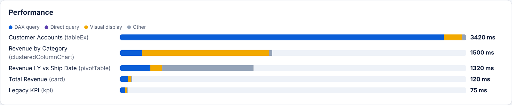
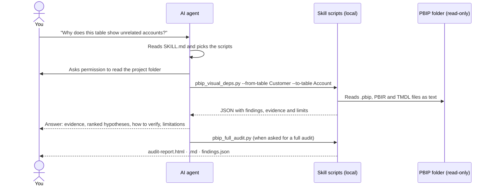
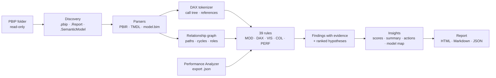

<div align="center">


# Power BI PBIP Forensics

### Ask your AI agent *why* your Power BI report behaves the way it does, and get answers backed by evidence from your project files.


[What it does](#-what-it-does) •
[Report tour](#-report-tour) •
[How the skill works](#-how-the-skill-works) •
[Quick start](#-quick-start) •
[Ask it](#-what-you-can-ask) •
[Engine](#%EF%B8%8F-inside-the-engine) •
[Scripts](#-skill-scripts) •
[Safety](#%EF%B8%8F-safety-and-privacy) •
[Developers](#-for-developers)

<br>



<sub>Interactive HTML report generated from the bundled synthetic project (`examples/synthetic_project`).</sub>

</div>

---

## 🔎 What it does

**Power BI PBIP Forensics** is an AI agent skill, with a Python engine behind it, that audits Power BI projects
saved in the **PBIP** format. It reads the report definition (**PBIR**) and the semantic model (**TMDL** or
`model.bim`) as text, builds the relationship graph and the DAX dependency graph, and explains:

- 🔗 **Filters that do not propagate**: inactive relationships, one-way relationships blocking the path, disconnected tables, ambiguous paths.
- 🧮 **DAX problems**: missing references, circular dependencies, `ALL`/`REMOVEFILTERS` overriding slicers, totals that differ from the visible rows, costly patterns.
- 📊 **Broken visuals**: fields that no longer exist in the model, tables combined without a relationship, page filters that cannot reach the measures.
- 🧹 **Cleanup opportunities**: unused measures and columns, measures without a format, visible foreign keys, auto date tables, overloaded pages.
- 🐢 **Slow visuals**: ranked from a Performance Analyzer export (*preview*).
- 🔀 **Change impact**: what changed between two versions, and which measures and visuals to retest.

It is written for **two audiences at once**: a business user gets a health score, a plain-language summary and a
short list of what to fix first; a BI developer gets file paths, line numbers, evidence and a way to verify each
finding.

Every finding states:

| | |
|---|---|
| **Where** | File path, line and object |
| **Why** | The evidence that triggered it |
| **How sure** | `confirmed` · `potential` · `inconclusive` |
| **What to do** | A suggested fix |
| **How to verify** | A check you can run in Power BI Desktop |

## 🖼️ Report tour

One command produces a single self-contained HTML file (no internet needed, light and dark themes, works on
mobile), plus Markdown and JSON versions. All screenshots below come from the bundled synthetic project.

### 1. Health score and plain-language summary

Six gauges score the data model, DAX measures, report & visuals, performance and project files. The score is an
**indicative** summary of the findings, and its formula is printed in the report. Below the gauges, a short
summary explains the situation without jargon.



### 2. What to do first

Findings are grouped by rule and turned into actions, ranked by severity and effort (**quick win**, **medium
effort**, **structural**). Each card links to the detailed findings.



### 3. Findings with evidence

Filter by severity, status, category or rule, or search by text. Each finding opens to show the source file, the
evidence, the impact, a recommendation and how to verify it.



### 4. Model map

The relationship diagram is laid out in layers: dimensions, bridges, facts and disconnected tables. Inactive
relationships are dashed, bidirectional ones are orange and **ambiguous filter paths are red**. Auto date tables
are hidden to keep the map readable.



### 5. Measures

The most complex measures (functions, iterators, nesting, dependency depth), the central measures that the rest
of the model depends on, and how measures are spread across display folders.



### 6. Pages and performance

One card per page shows visuals, slicers, filters, measures, custom visuals, broken bindings and the tables used.
When a Performance Analyzer export is available, visuals are ranked by measured time split into DAX query,
visual display and other.




The report also includes a rules overview, change impact, root-cause hypotheses, recommended actions, limitations
and the full inventory (tables, columns, measures, relationships and data-source connectors).

## 🤖 How the skill works

The skill is a folder with a `SKILL.md` (instructions for the agent), seven standalone Python scripts,
references and answer templates. You talk to the agent; the agent decides which scripts to run.



1. **Trigger.** You ask a question about a Power BI project, or ask for an audit.
2. **Scope.** The agent asks which folder it may read and writes outputs to a separate folder.
3. **Analysis.** The agent runs only the scripts the question needs: inventory, model audit, visual
   dependencies, performance log, diff, or the one-shot full audit.
4. **Answer.** The agent keeps **script evidence** separate from **its own reasoning**, ranks hypotheses by
   confidence, tells you how to verify each one in Power BI Desktop, and states the limits of a static analysis
   (template: [`templates/investigation-response.md`](agensi/powerbi-pbip-forensics/templates/investigation-response.md)).
5. **Report.** For audits, it produces the interactive HTML report shown above.

Nothing is executed from the project: DAX, M and JSON are parsed as data. Nothing leaves your machine.

## 🚀 Quick start

> **Requirements:** Python **3.11+** (standard library only) and a report saved as a Power BI project
> (*File → Save as → Power BI project (.pbip)*). Binary `.pbix` files are not supported.

### Option A: as an agent skill

1. Get the skill: buy it on **Agensi**, or use the folder `agensi/powerbi-pbip-forensics/` from this repository.
2. Install it where your agent loads skills. For **Claude Code**:

   ```powershell
   # Windows (PowerShell)
   Copy-Item -Recurse .\agensi\powerbi-pbip-forensics "$env:USERPROFILE\.claude\skills\powerbi-pbip-forensics"
   ```

   ```bash
   # Linux / macOS
   cp -r agensi/powerbi-pbip-forensics ~/.claude/skills/powerbi-pbip-forensics
   ```

   For other agents, point them to `SKILL.md`. Any agent that can read Markdown and run local Python scripts can
   use the skill.
3. Open your agent in the folder that contains your `.pbip` project and ask a question (see below).

### Option B: one-click audit (Windows)

Drag your PBIP project folder onto **`pbip-audit.cmd`**, or run:

```powershell
.\pbip-audit.cmd "C:\BI\MyProject"
```

It skips backup folders, auto-detects a Performance Analyzer export inside the project, writes the report to
`C:\BI\MyProject-forensics\` and opens the HTML report. The equivalent engine command is
`py -m pbip_forensics run --project <folder> --open --lang pt-BR` (with `PYTHONPATH=src`).

### Option C: run the scripts yourself

```powershell
$S = ".\agensi\powerbi-pbip-forensics\scripts"
$P = "C:\BI\MyProject"        # your PBIP folder (read-only)
$O = "C:\BI\audit"            # output folder, must be outside the project

py $S\pbip_full_audit.py --project $P --output $O --lang pt-BR      # everything + HTML report
py $S\pbip_visual_deps.py --project $P --from-table Customer --to-table Account --output $O
```

Open `C:\BI\audit\audit-report.html`. Use `--lang pt-BR` for Brazilian Portuguese headings and summaries.

## 💬 What you can ask

| You ask the agent | It checks |
|---|---|
| *"Audit this project before I publish it."* | All rules, health score, prioritised actions, full HTML report |
| *"Why is the Customer Accounts table showing accounts unrelated to the selected customer?"* | Relationship paths hop by hop, inactive or one-way relationships, visual bindings |
| *"Why does **Total Revenue** ignore my slicer?"* | `ALL` / `REMOVEFILTERS` / `CROSSFILTER` in the measure and its dependencies |
| *"My total is different from the sum of the rows. What should I check?"* | Non-additive patterns (`IF` on measures, `DISTINCTCOUNT`, `HASONEVALUE`), many-to-many relationships |
| *"What can I delete to make the model lighter?"* | Unused measures and columns, auto date tables, isolated tables |
| *"Which visuals are slowing this page down?"* | Measured DAX query, visual display and *Other* times from your Performance Analyzer export |
| *"Compare `v1` and `v2`. What do I need to retest?"* | Changed measures, columns and relationships, and every dependent measure and visual |

### Example answer

Real script output from `examples/synthetic_project`:

```text
VIS006  HIGH  potential  Unrelated tables combined in 'Customer Accounts' (tableEx): 'Account' and 'Customer'
        No active relationship path between them in either direction
        → ContosoRetail.Report/definition/pages/overview01/visuals/v_table_accounts/visual.json

MOD002  LOW   potential  Inactive relationship not activated by any measure: Account -> Customer
        'Account'[CustomerKey] (many) -> 'Customer'[CustomerKey] (one) · isActive: false
        → ContosoRetail.SemanticModel/definition/relationships.tmdl:27

Investigation  Customer → Account
  BLOCKED PATH: 'Customer' -> 'Account' via 'Account'[CustomerKey] -> 'Customer'[CustomerKey] [INACTIVE]
  #1 [high confidence] Inactive relationship on the only path from 'Customer' to 'Account'.
     Verify: confirm isActive=false in Model view; test a measure with USERELATIONSHIP(...).
```

## ⚙️ Inside the engine



- **Real parsing, not guessing.** The TMDL parser follows indentation, so it handles multi-line expressions,
  triple-backtick blocks, quoted names, hierarchies and sort-by columns. The DAX tokenizer respects strings,
  comments and `[references]`. PBIR fields follow Microsoft's published JSON schemas, including fields used only
  in conditional formatting.
- **Graph algorithms.** Filter paths are direction-aware. Blocked paths are explained hop by hop. Ambiguous loops
  are separated from harmless ones, and measure cycles are found with Tarjan's algorithm.
- **False-positive safeguards.** Lookup and parameter tables, measures that link tables, role-playing dates and
  formatting-only references are recognised. Each rule's safeguard is documented.
- **Honest statuses.** `confirmed` means proven by the files or measured in a log. `potential` means a risk to
  verify. `inconclusive` means the engine could not interpret it. No invented percentages, values or timings.

| Rule family | What it covers |
|---|---|
| `PRS` / `SEC` | Parsing problems, missing files, unsupported formats, items skipped by the safety policy |
| `MOD001`–`MOD010` | Broken, inactive, bidirectional, many-to-many and ambiguous relationships; disconnected tables; key type mismatch; auto date tables; visible foreign keys |
| `DAX001`–`DAX014` | Missing references, circular dependencies, costly `FILTER`/iterators/context transition, filter overrides, non-additive totals, `/` without `DIVIDE`, unused or unformatted measures |
| `VIS001`–`VIS008` | Broken bindings, uninterpretable visuals, filters that cannot reach measures, unrelated tables in a grid, overloaded pages |
| `COL001` | Columns with no detected use |
| `PERF001` | Visuals over the measured time thresholds |

Full rule list with severities and safeguards: [docs/diagnostic-rules.md](docs/diagnostic-rules.md).

**Health score formula:** `score = 100 × exp(−Σ weight(severity) × factor(status) / 40)`, with weights CRITICAL 20,
HIGH 8, MEDIUM 3, LOW 1, INFO 0 and factors confirmed 1, potential 0.5, inconclusive 0.25. The overall score is the
mean of the measured areas. It summarises the findings; it is not a quality certificate.

## 🧰 Skill scripts

Each script is **standalone**: one file, Python standard library only, no network. It reads only the paths you
pass, writes only to `--output`, and works on Windows, Linux and macOS.

| Script | Purpose | Main arguments |
|---|---|---|
| `pbip_full_audit.py` | **One-shot**: all analyses + interactive HTML/Markdown/JSON report | `--project` `--output` `--lang` |
| `pbip_inspect.py` | Inventory of reports, pages, visuals, tables, measures, relationships and data-source connectors | `--project` |
| `pbip_model_audit.py` | Relationship and model structure checks plus DAX static analysis | `--project` |
| `pbip_visual_deps.py` | Page → Visual → Field → Table map, broken bindings, filter investigation | `--project` `--from-table` `--to-table` `--measure` `--visual` |
| `pbip_perf_log.py` | Ranks visuals by measured duration *(preview)* | `--input` `--medium-ms` `--high-ms` |
| `pbip_diff.py` | Changes between two versions and their impact | `--before` `--after` |
| `pbip_report.py` | Merges the JSON outputs into Markdown, HTML and JSON | `--input …` `--format` `--lang en\|pt-BR` |

**Exit codes:** `0` OK · `2` invalid input · `3` size limit exceeded · `4` refused by the safety policy ·
`5` invalid performance log · `10` internal error.

## 🛡️ Safety and privacy

- **Read-only.** The project is never modified, and reports must be written outside it.
- **Scope-locked.** Only the folder you authorize is read. Symbolic links that point outside it are not followed.
- **No secrets.** `.env`, keys, certificates, `localSettings.json` and `cache.abf` are never opened. Only connector
  names (for example `Sql.Database`) are reported, never connection strings or credentials.
- **No execution.** DAX, M and JSON are parsed as data and never evaluated.
- **No network.** Everything runs locally and offline; the HTML report has no external resources.
- **Untrusted content.** Text inside the project, such as measure names and descriptions, is treated as data and
  never as instructions. HTML output is escaped.

## ⚠️ Limitations

- **Static analysis.** No DAX is executed and no data is read, so the skill never claims values or totals.
- **Formats.** PBIX/PBIT are not supported. Support for the older PBIR-Legacy report format is best-effort.
- **Usage scope.** Unused measures/columns are reported only when every bound report is PBIR and fully
  interpretable; RLS roles, other reports and external tools are not visible. Confirm with lineage before removing.
- **Not modelled:** calculation groups, row-level security, `TREATAS` virtual relationships, and visual
  interactions or bookmarks.
- **Performance Analyzer (preview).** Validated with synthetic exports only.
- **Language.** Finding texts are in English. Headings, scores, summaries and action titles are available in
  English and Brazilian Portuguese.

Details: [docs/limitations.md](docs/limitations.md).

---

## 👩‍💻 For developers

<details>
<summary><b>Engine CLI</b></summary>

```bash
pip install -e ".[dev]"
pbip-forensics run         --project ./examples/synthetic_project [--lang pt-BR] [--open]
pbip-forensics scan        --project ./examples/synthetic_project
pbip-forensics audit       --project ./examples/synthetic_project --output ./reports [--performance perf.json] [--fail-on HIGH]
pbip-forensics investigate --project ./examples/synthetic_project --from-table Customer --to-table Account
pbip-forensics performance --input ./examples/sample_performance/performance.json
pbip-forensics diff        --before ./examples/synthetic_project --after ./examples/synthetic_project_v2
pbip-forensics report      --input ./reports/findings.json --format html
```

`--fail-on` returns exit code 1 when there are findings at or above the given severity, which is useful in CI.
</details>

<details>
<summary><b>Repository layout</b></summary>

```text
src/pbip_forensics/     engine: security · discovery · parsers · graph · analyzers · findings · reporting · cli
agensi/powerbi-pbip-forensics/   the skill: SKILL.md · scripts/ (generated) · references/ · templates/
tools/                  build_skill · package_agensi · make_fixtures · run_demo · gen_docs · script_metrics
tests/                  unit · integration (including isolated script parity) · fixtures (synthetic)
examples/               synthetic projects · sample Performance Analyzer log · sample reports
docs/                   architecture · formats · rules · limitations · validation · Agensi docs · assets
```
</details>

<details>
<summary><b>Tests and packaging</b></summary>

```bash
python -m pytest -o addopts="" -q     # 101 tests
ruff check src tests tools && mypy
python tools/build_skill.py           # regenerate standalone scripts from the engine
python tools/gen_docs.py              # regenerate the rule catalog docs
python tools/package_agensi.py        # build and validate dist/powerbi-pbip-forensics-v1.0.0.zip
```

Each generated script is also run alone, under `python -I`, and its output is compared with the engine's.
See [docs/validation-results.md](docs/validation-results.md).
</details>

### Documentation

| | |
|---|---|
| [Architecture](docs/architecture.md) | Modules, data flow, skill bundling |
| [Supported formats](docs/supported-formats.md) | PBIP / PBIR / TMDL / TMSL / Performance Analyzer fields and versions |
| [Diagnostic rules](docs/diagnostic-rules.md) | Every rule, its severity, status and false-positive safeguards |
| [Limitations](docs/limitations.md) | What is out of scope |
| [Validation results](docs/validation-results.md) | Measured tests, coverage, timing, parity |
| [SKILL.md](agensi/powerbi-pbip-forensics/SKILL.md) | Operational instructions for agents |
| [Publishing on Agensi](docs/PUBLISH_AGENSI.md) | Submission and post-publication test |
| [Changelog](CHANGELOG.md) | Release history |

## 📄 License

Copyright © 2026 **Vinicius de Souza Santos**. All rights reserved. This is proprietary software, and access to
this repository does not grant any right to use, copy or redistribute it. See [LICENSE](LICENSE).

Power BI, PBIP, PBIR, TMDL and DAX are Microsoft technologies. This project is not affiliated with or endorsed by
Microsoft.

<div align="center">
<sub>Made by <a href="https://github.com/ViniciusKanh">Vinicius de Souza Santos</a> · v1.0.0</sub>
</div>
